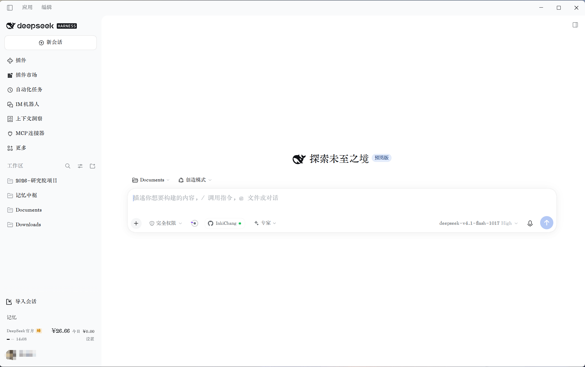
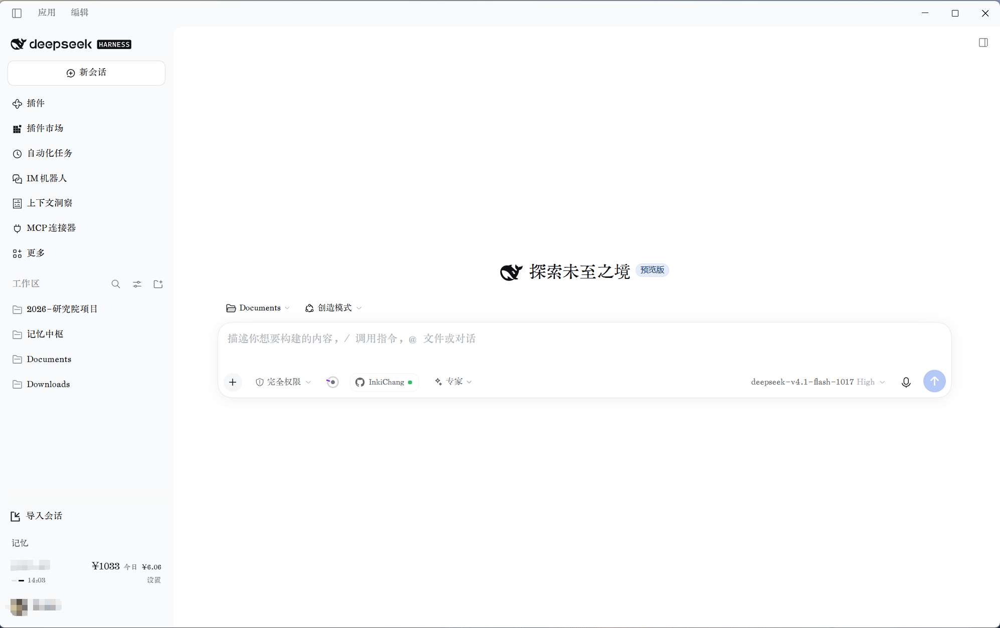
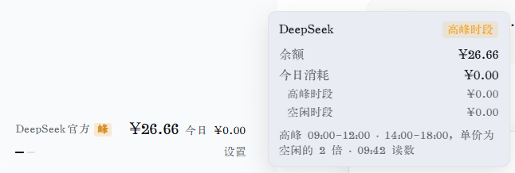
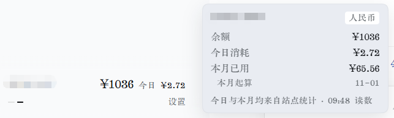
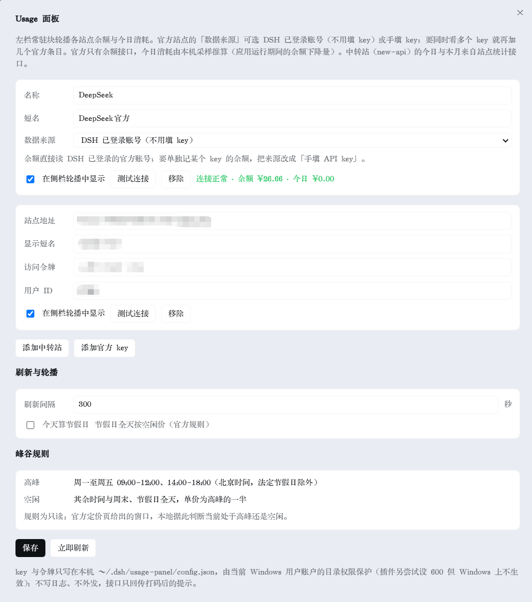

# dsh-usage-panel

给 DeepSeek Harness 加一块**侧栏常驻用量面板**：轮播显示 DeepSeek 官方账号（或手填的官方 API key）与各中转站（new-api 系）的余额、今日消耗，官方站点额外标注当前处于高峰还是空闲时段。

## 这是什么

DSH 本身不展示 API 用量。这个插件在左侧边栏底部放一个小块，把「还有多少钱、今天花了多少」直接摆在眼前，不用每次打开各个站点的后台。这块面板**嵌在侧栏底部的正常顺序里**——排在「记忆」这类入口下面、账号那一行（头像 + 用户名）的上面——不是浮在界面之上的浮层。

- 官方站点：余额来自 `https://api.deepseek.com/user/balance`。若 DSH 已登录官方账号，**无需填写 key**，直接读账号余额；也可以改成「手填 API key」来单独盯某一个 key。**手填 key 属未验证路径**（原因见「已知限制」）。
- 中转站：按 new-api 的接口形态读取配额与消费统计，支持多个站点并列轮播。
- 高峰/空闲：官方定价在工作日高峰时段是空闲时段的 2 倍，块上用一个「峰 / 闲」字块标出来，配合悬停浮层里的高峰、空闲分账。

## 功能

| 能力 | 说明 |
| --- | --- |
| 侧栏常驻块 | 嵌在侧栏底部：排在「记忆」这类入口下面、账号行上面，宽度与左缩进跟旁边的入口对齐 |
| 多站点轮播 | 官方账号、多个官方 key、多个中转站可同时存在，按间隔轮播 |
| 不遮挡别的入口 | 面板占的是侧栏里的真实位置，其它插件往底部加入口时是往上长，两边互不侵占 |
| 余额 + 今日消耗 | 每个站点两行数字，未配置或出错时给出原因与入口 |
| 峰 / 闲字块 | 仅官方站点显示，颜色随主题自适应 |
| 悬停浮层 | 余额与今日消耗；中转站另有本月已用、本月起算日，官方另有高峰/空闲分账 |
| 手动刷新 | 点击块上的时间即可立即刷新 |
| 设置浮层 | 增删站点、测试连接、显示开关、刷新间隔，全部在面板内完成 |
| 只存本机 | 令牌与 key 落在 `~/.dsh/usage-panel/config.json`，不外发 |

### 为什么它不会盖住别的东西

早期版本是把面板「浮」在侧栏上方的，位置靠一个参照点估算。参照点一变，或者别的插件在底部加了入口，就会互相重叠、点不到。

现在改成**嵌入**：面板排在侧栏底部入口（如「记忆」）的下面、账号那一行的上面，和它们一样按正常顺序占位置。好处有三个：

1. **谁也盖不到谁。** 别的插件再往底部加入口，是往上加；面板的位置不动，两边互不侵占。
2. **位置稳定。** 不管窗口多大、主题深浅、轮播到哪个站点，它都在账号行的正上方。
3. **看起来就是侧栏的一部分。** 透明底、没有边框；左边距不是写死的数字——每次刷新都按「记忆」两个字实际开始的位置量一遍，所以缩放窗口、切换主题都不会错位。

### 它是怎么做到的

没有改动 DSH 本身，全部在插件内部完成：

1. 面板启动后先看一眼侧栏底部，找到账号那一行（有头像和用户名的那一行）。
2. 在它上面放一个透明的「空位」，高度等于面板本身的高度；侧栏会把下面的内容往下推一点，空出来的地方正好放一张面板。
3. 面板画在这个空位里；左边的缩进按「记忆」文字的起始位置实时量出来。
4. DSH 重画侧栏时空位可能被清掉，插件每秒检查一次，掉了就补回去。

### 这样做的代价

说清楚比藏着好：

1. **侧栏底部会多占一张面板的高度**（约 56 像素），会话列表能看到的行数相应少一点——这是「不遮挡」的必然代价。
2. **依赖 DSH 侧栏现在的样子。** 如果以后 DSH 大改侧栏（账号行挪位置、底部入口换成别的形式），插件可能一时找不到合适的位置；这时会自动退回原来的做法（贴在「记忆」上方），功能都还在，只是位置可能不完美。
3. **偶尔可能闪一下。** 上面第 4 步补空位的那一下，理论上能看到一次重排；实测中很难察觉。
4. **没有占用 DSH 的官方入口位。** 它不是在插件入口表里注册一格，所以不会和「记忆」「导入会话」抢位置，也不会被它们的增减挤走；反过来，它也没有它们那种「由 DSH 统一排版」的待遇——位置是插件自己算的。

## 界面

截图取自真实桌面端窗口，站点名与令牌已打码。两张侧栏图里都能看到面板嵌在「记忆」下面、账号那一行上面。

侧栏常驻块 · 官方站点（`峰` 字块表示当前处于高峰时段）：



侧栏常驻块 · 中转站：



悬停展开 · 官方站点（余额、今日消耗，以及高峰与空闲分账）：



悬停展开 · 中转站（今日与本月来自站点统计接口）：



设置浮层（在面板内增删站点、测试连接、调整刷新间隔）：



## 安装

需要已安装 DSH（桌面端或 `@deepseek-ai/dsh` 均可）。把本仓库目录作为插件包安装：

```text
# 在 DSH 会话里让插件管理器安装本地目录（换成你的绝对路径）
plugin_manager action=install_bundle target="C:\path\to\dsh-usage-panel"
```

安装或卸载插件后，**完整退出并重启一次 DSH**，否则侧栏看不到这块面板。原因：DSH 在进程启动时读取插件清单、注册插件的后端入口与前端资源；运行中的进程不会因为重新安装而重建这张表，只刷新页面（Ctrl+R）同样加载不到新装的代码。实测表现是：插件文件已经在磁盘上，页面刷新后前端资源仍然 404、侧栏位置为空。

分辨规则只有一条：包**已经装好**、代码只是改了 `client.js`（界面代码）时，Ctrl+R 就能取到新版本；改了 `index.js`（插件后端）或重新装卸过插件，就必须重启。

## 快速开始

1. 左栏底部出现用量块后，点块上的「设置」（尚未配置时显示「去设置」），或从 `设置 → Usage 面板` 进入。
2. 官方站点：默认「数据来源」为 **DSH 已登录账号**，只要是已登录状态就会显示余额；想单独盯某个 key，把来源改成「手填 API key」并填入 key。
3. 添加中转站：填站点地址（例如 `https://relay.example.com`）与**访问令牌**。部分站点还要求填写数字用户 ID（响应头 `New-Api-User`），填入后即可正常取数。
4. 点「测试连接」确认能读到余额，再保存。

## 数据口径

### 官方站点

- 余额：`GET /user/balance`，取 `balance_infos` 中人民币项。
- **今日消耗：本机采样推算**。官方只提供余额接口，没有用量明细，所以插件记录余额随时间的变化，用「当日首个样本余额 − 当前余额」估算今日消耗，并按采样时刻判断该笔消耗落在高峰还是空闲时段。
- 推论：**DSH 没运行的时段不会被统计**，插件首次使用当天从启动时刻起算。
- 端点与时段规则：高峰为北京时间周一至周五（不含法定节假日）`09:00-12:00`、`14:00-18:00`，其余时间为空闲，空闲单价为高峰的一半。设置里的「今天算节假日」开关用于临时调整判定。

### 中转站（new-api 系）

- 余额：`GET /api/user/self` 的 `data.quota` 除以 `quota_per_unit`（来自 `GET /api/status`，默认 500000）得到基础金额；站点开启 `display_in_currency` 时再乘以 `usd_exchange_rate`（默认 7），单位按人民币显示，否则按美元显示。
- 今日 / 本月已用：按优先级尝试三种接口，取到即止——
  1. `GET /api/data/self`（区间汇总，直接给 `quota`）
  2. `GET /api/log/self/stat`（区间统计）
  3. `GET /api/log/self`（明细列表逐条累加；单页被填满 100 条时视为统计不完整，不使用该结果）
- 「本月起算」显示自然月首日，说明本月已用是从月初累计到现在，不会随账单日回退。

## 配置项

| 配置 | 位置 | 说明 |
| --- | --- | --- |
| 刷新间隔 | 设置浮层 | 默认 300 秒，最小 60 秒 |
| 显示哪些站点 | 设置浮层 | 关闭后该站点不参与轮播 |
| 数据来源 | 官方站点卡片 | `DSH 已登录账号` 或 `手填 API key` |
| 用户 ID | 中转站卡片 | 站点要求 `New-Api-User` 时填写 |
| 今天算节假日 | 设置浮层 | 强制把今天按空闲时段计价 |

配置文件：`~/.dsh/usage-panel/config.json`（站点与令牌）、`~/.dsh/usage-panel/samples.json`（余额采样，保留 4 天）。

## 隐私与安全

- 所有请求只发往你在设置里填写的站点，以及 `api.deepseek.com`；没有第三方统计上报。
- 令牌只写本机配置文件，界面上只显示前三位与后四位（例如 `abc…wxyz`）。
- Windows 上 `chmod 600` 不生效，配置文件的实际保护来自用户目录权限；插件仍会尝试设置，失败不影响使用。
- 插件提供的是本机只读诊断接口 `GET /plugin/usage-panel/report`，内容仅为版面几何信息，不含令牌。

## 已知限制

- **手填官方 API key 是未验证路径**：官方目前只对外提供 `/user/balance`，本机没有可用的官方 key，这条分支未经实测。它是「已登录账号」之外的可选来源，遇到问题时先改回账号来源再排查。
- 官方今日消耗是采样估算，精度等于刷新间隔；插件未运行期间的消费不会被记录。
- 中转站只按 new-api 的接口形态适配。其他面板（如 one-api 的不同分支）字段不一致时可能需要改 `index.js` 里的取数函数。
- 不做跨站汇总：侧栏按站点轮播，浮层只显示当前站点自己的数字（不同站点的余额与单位不可直接相加）。
- 只读取用量，**不会**触发任何计费操作。
- 「嵌入显示」是靠「在侧栏底部找一个空位并占住它」实现的：读的是 DSH 侧栏现有的结构，不是官方提供的接口。宿主大改侧栏结构时这一处需要重新适配（症状是面板退回贴在「记忆」上方，其它功能不受影响）。

## 开发

```
index.js            插件后端：取数、采样、配置读写、本地 HTTP 接口
client.js           界面部分：侧栏常驻块、悬停浮层、设置浮层
cordis.patch.yml    装配入口
locale/             中英文显示元数据
icon.svg            插件图标
docs/screenshots/   真实截图
```

开发时的生效规则：只改 `client.js` → Ctrl+R 即可；改 `index.js`、或动过 `package.json` / `cordis.patch.yml` → 完整退出重启。

## 许可

[MIT](LICENSE)
